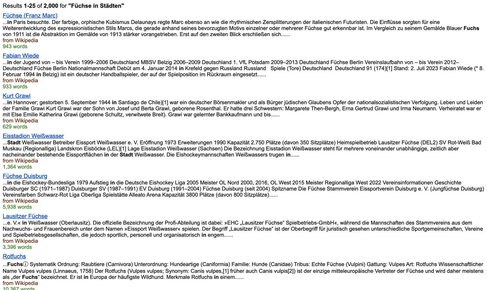
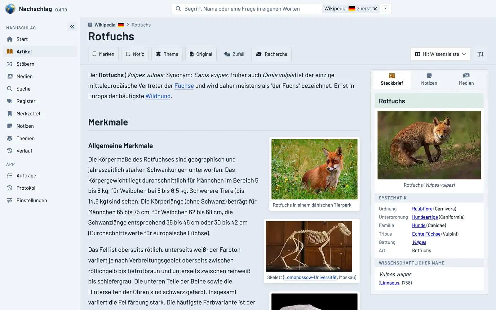
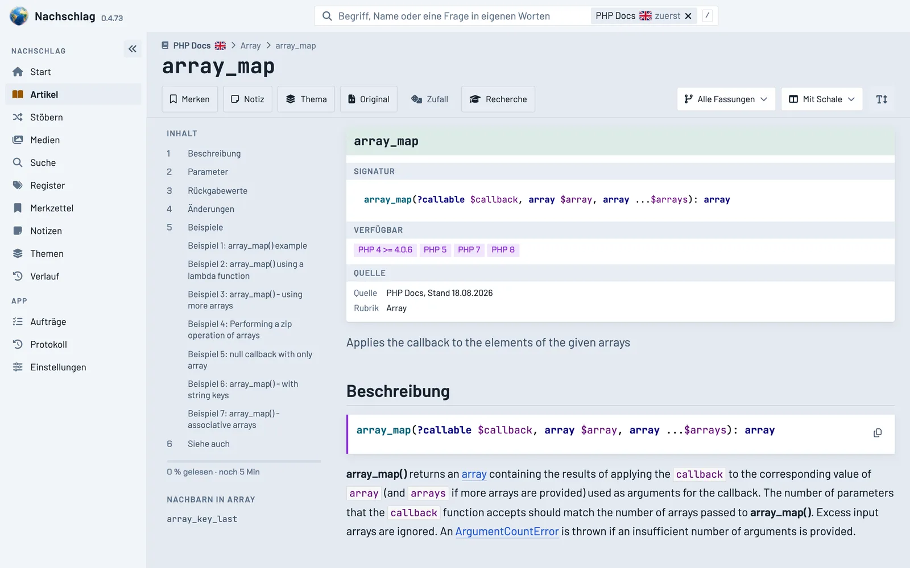
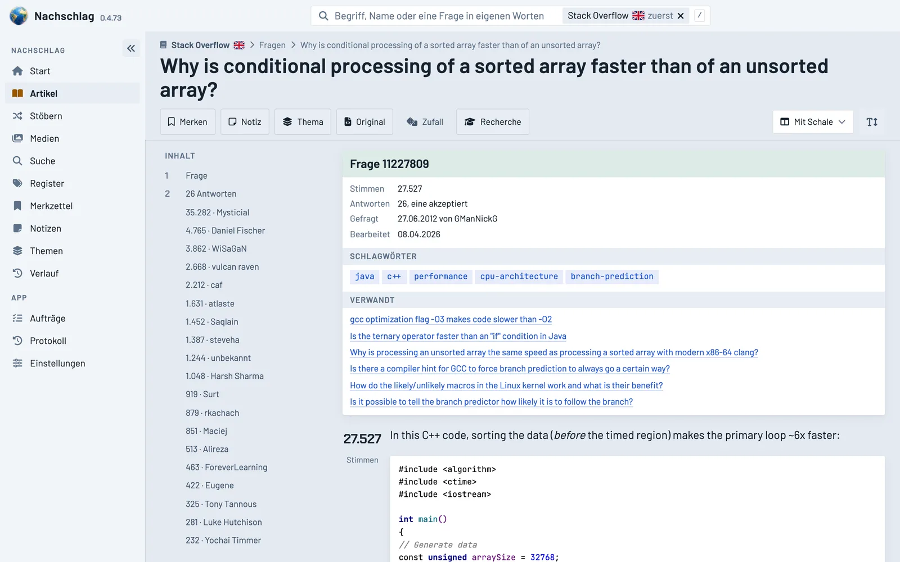
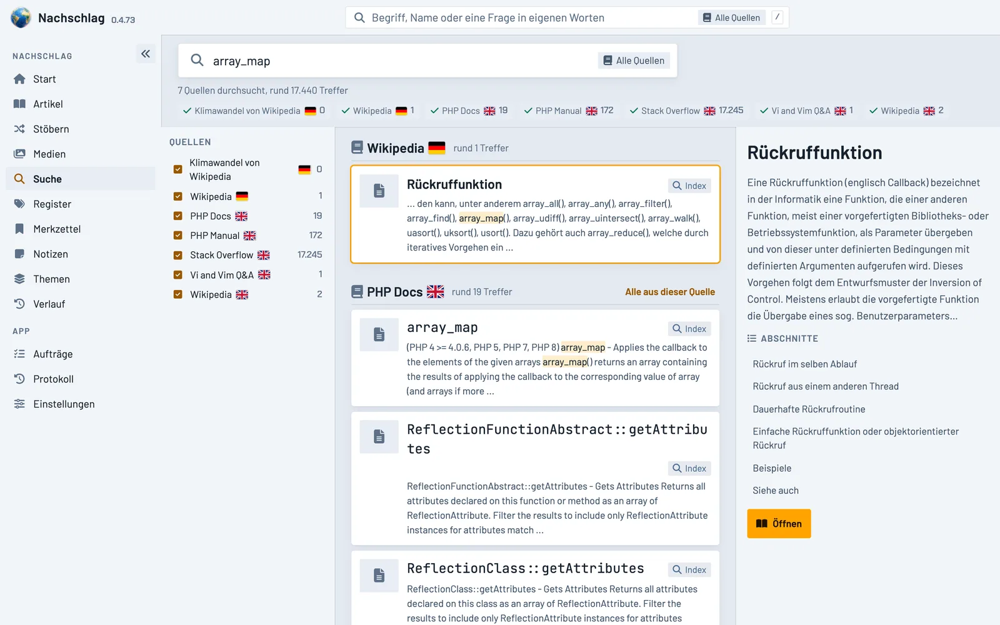

import Zeichnung from "../../components/Zeichnung.astro";
import lupe from "./nachschlag-wissen-offline-lupe.webp";
import sandkasten from "./nachschlag-wissen-offline-sandkasten.webp";
import lesezeichen from "./nachschlag-wissen-offline-lesezeichen.webp";
import lautsprecher from "./nachschlag-wissen-offline-lautsprecher.webp";
import laptop from "./nachschlag-wissen-offline-laptop.webp";
import gleise from "./nachschlag-wissen-offline-gleise.webp";

Auf meinem Raspberry Pi liegen die komplette deutsche und englische Wikipedia, ganz Stack Overflow, zwei
PHP-Handbücher und ein paar kleinere Sammlungen: 7 Dateien, rund 291 GB, zusammen 42,27 Millionen Seiten. Alles
stammt als ZIM-Datei aus dem Katalog des Kiwix-Projekts und lässt sich dort fertig herunterladen. Zum Lesen liefert
Kiwix einen eigenen Reader mit. Zum Arbeiten hat er mir nicht gereicht, deshalb habe ich einen neuen gebaut.

Nachschlag ist im Prinzip eine Neuauflage von Kiwix mit eigenen Mitteln. Die ZIM-Dateien bleiben unverändert die
Grundlage. Ansicht, Suche und alle Werkzeuge zum Lesen sind neu geschrieben.

**Das Wichtigste in Kürze**

- **Die Suche des Originals trifft oft daneben.** Zu "Füchse in Städten" findet sie 2.000 Treffer. Ganz oben stehen
  ein Gemälde von Franz Marc, ein Handballspieler und zwei Eishockeyvereine, der Rotfuchs kommt auf Platz 7.
- **Jede Inhaltsart bekommt eine eigene Ansicht.** Der Reader baut jede Seite beim Aufruf um. Eine Enzyklopädie
  bekommt eine Infobox, ein Handbuch eine Signatur, eine Frage aus Stack Overflow Votes und Tags.
- **Zwei Suchen arbeiten zusammen:** ein eigener Volltextindex je Quelle und eine semantische Suche über Embeddings
  mit BGE-M3. Fällt die semantische Suche aus, liefert der Index allein, und die Seite sagt das dazu.
- **Notizen und Markierungen hängen an Textstellen.** Dazu kommen Zitieren, Übersetzen mit sichtbarer Kennzeichnung
  und Vorlesen. Codebeispiele laufen in einer Sandbox und lassen sich Schritt für Schritt debuggen.
- **Der Kern braucht nur einen Ordner mit ZIM-Dateien.** Alle KI-Funktionen sind zuschaltbare Anbindungen. Ist eine
  nicht erreichbar, blendet der Reader die Funktion aus.
- **Der Code ist offen:** [HalloWelt42/nachschlag](https://github.com/HalloWelt42/nachschlag).

## Ausgangslage

Kiwix ist ein offenes Projekt, mit dem sich Wikipedia seit 2006/2007 ohne Internet lesen lässt. Gedacht war es vor allem für
Gegenden mit schlechtem oder teurem Netz und für Schulen in Entwicklungsländern. Auf den Rechnern der Initiative
"One Laptop per Child", dem sogenannten 100-Dollar-Laptop, kam die Wikipedia mit Kiwix auf die Geräte.

Inzwischen bündelt der Katalog die Inhalte vieler offener Plattformen und Foren: Enzyklopädien, Wörterbücher,
Programmierhandbücher, Frage-und-Antwort-Archive, gespiegelte Webseiten. Am 1. November 2026 standen dort 3.656
Bücher, davon 311 auf Deutsch und 1.309 auf Englisch. Jedes Buch ist eine einzelne ZIM-Datei mit allen Seiten,
Bildern und einem eingebauten Index für Titel und Volltext.

<Zeichnung bild={laptop} text="Zeichnung: ein robuster Laptop mit aufgeklapptem Deckel, vor dem Bildschirm schwebt ein Globus" />

Die großen Bücher im Überblick:

| Buch | Seiten | Größe |
|---|---|---|
| Wikipedia Deutsch, mit Bildern (Stand Januar 2026) | 3,2 Mio Artikel | 52,4 GB |
| Wikipedia Englisch, mit Bildern (Stand Februar 2026) | 8,4 Mio Artikel | 124,0 GB |
| Stack Overflow (Stand Juli 2026) | 30,6 Mio Fragen | 114,9 GB |
| PHP-Handbuch, zwei Versionen | 19.159 Seiten | 40 MB |

Der mitgelieferte Web-Reader zeigt diese Inhalte an und durchsucht sie. Seine Suche zählt Wörter und sortiert danach.
Was gemeint ist, erkennt sie nicht. Englische Quellen bleiben englisch. Notizen, Markierungen oder einen Merkzettel
gibt es nicht. Eine Seite aus einem Frage-Antwort-Archiv sieht aus wie eine gespeicherte Webseite, weil sie genau das
ist.

## Was entstanden ist

<Zeichnung bild={gleise} text="Zeichnung: zwei Stapel derselben Bücher, einer durcheinander, einer ordentlich im Regal" />

### Dieselben Dateien in neuer Ansicht

Der Reader nimmt alle ZIM-Dateien eines Ordners. Er wandelt vorab nichts um und kopiert nichts. Ruft man eine Seite
auf, liest er sie aus der Datei (gemessen rund 12 ms für einen Wikipedia-Artikel auf dem Pi) und baut sie live um.

Für jede Inhaltsart mit eigener Grundstruktur gibt es ein eigenes Modul mit eigenen Methoden und eigenem Layout.
Welche Art vorliegt, erkennt der Reader an den Angaben in der Datei, nie am Dateinamen. Drei Module gibt es heute:

- **Enzyklopädie:** Inhaltsverzeichnis an der Seite, die Infobox als eigener Kasten, neu gesetzte Bilder, große
  Schrift, drei umschaltbare Ansichten.
- **Dokumentation:** Signatur, verfügbare Versionen, Rubrik und Nachbarn im Kopf, Code mit eigenem Farbschema für
  hell und dunkel, dazu ein Versionsfilter ("nur, was es in PHP 8.3 gibt").
- **Frage und Antwort:** Votes, Antworten, akzeptierte Lösung, Tags, verwandte Fragen und ein Register aller Autoren.

Inhalte ohne passendes Modul öffnen in der Originalansicht, abgeschirmt in einem iframe. So bleibt jede ZIM-Datei
lesbar, auch eine ganz neue.

Beim Bauen zeigte sich, wie unterschiedlich die Dateien aufgebaut sind. Die Bilder der großen Wikipedia-Ausgabe sind
Vorschaubilder mit 250 bis 330 Pixeln Breite. Interne Verweise ohne Ziel sind selten (0,3 bis 0,7 % in einer
Stichprobe), und fast alle davon zeigen auf Koordinaten. Offline tot sind vor allem die Verweise ins Netz. Der
Reader sammelt sie deshalb unter dem Artikel.

### Suche über Index und Semantik

<Zeichnung bild={lupe} text="Zeichnung: eine Lupe auf einem Stapel aus drei dicken Büchern" />

Der eingebaute Index einer ZIM-Datei antwortet schnell (rund 11 ms auf dem Pi) und kennt nur Wörter. Deshalb baut der
Reader für jede Quelle einen eigenen Volltextindex (SQLite FTS5), abgestimmt auf die Inhaltsart. Bei Handbüchern
zählt zuerst der genaue Funktionsname, dann der Wortanfang, dann der Text. Wer "str_rep" tippt, findet str_repeat und
str_replace. Bei Frage und Antwort zählen Titel, Tags, Frage und die akzeptierte Antwort.

Die Indizes rechnet ein Mac. Er holt sich den Auftrag beim Pi ab, liest das Buch über eine Freigabe im Heimnetz, baut
fortsetzbar und lädt das Ergebnis in Teilen hoch. Der Pi tauscht den Index erst aus, wenn die Prüfsumme stimmt.
Fällt das WLAN aus oder schläft der Mac ein, geht es später an derselben Stelle weiter.

Für die semantische Suche wird die deutsche Wikipedia in Abschnitte zerlegt, das Modell BGE-M3 berechnet für jeden
ein Embedding. Eine Frage in eigenen Worten findet so den Abschnitt mit der Antwort, auch ohne gemeinsames Wort, und
springt direkt dorthin. Index und semantische Suche laufen gleichzeitig, die Ergebnisse werden nach Rang gemischt.
Kommt von der semantischen Suche rechtzeitig keine Antwort, zeigt die Seite das Ergebnis des Index mit einem Hinweis.

Innerhalb eines Buchs sucht die Suche zuerst dort, auf der Startseite in allen Quellen. Jede Quelle zeigt ihren
eigenen Stand: sucht, fertig mit n Treffern oder keine Antwort. Sucht man auf Deutsch und sind englische Quellen
dabei, übersetzt ein lokales Sprachmodell die Suchanfrage mit. Fachbegriffe, Code und Bezeichner lässt es stehen.

### Lesen, markieren, notieren

<Zeichnung bild={lesezeichen} text="Zeichnung: ein aufgeschlagenes Buch mit Lesebändchen und einer kleinen Bleistiftnotiz am Rand" />

Markierungen, Notizen und Zitate hängen an einer Textstelle. Eine Notiz kann einen Screenshot aus der Zwischenablage
enthalten, Zitate gibt es einfach, nach APA, nach DIN und als BibTeX. Dazu kommen ein Merkzettel, ein Verlauf über
alle Geräte und der Lesestand ("noch 5 Minuten").

In eigenen Themen sammle ich Artikel aus allen Quellen. Ein Thema kann eine gespeicherte Suche mitführen. Neue Treffer
daraus erscheinen als Vorschlag und landen erst nach "Übernehmen" im Thema. Ein Recherchemodus sammelt Quellen und
Notizen gemeinsam.

All das speichert der Reader je Konto auf dem Pi, deshalb sind Merkzettel und Verlauf auf jedem Gerät gleich.
Angemeldet wird mit dem Konto meiner eigenen kleinen Cloud im Heimnetz. Dort liegen auch die Bilder an Notizen, die
Ergebnisse der Nachtarbeit sowie die Bücher und Indizes als Ordner, sichtbar und gesichert wie jede andere Datei.

### Übersetzen und Vorlesen

<Zeichnung bild={lautsprecher} text="Zeichnung: ein aufgeschlagenes Buch, über dessen Seiten eine Tonkurve ausschlägt" />

Englische Artikel übersetzt dasselbe lokale Sprachmodell Abschnitt für Abschnitt ins Deutsche. Es übersetzt nur den
Text, Aufbau, Formeln, Tabellen, Code und Verweise bleiben erhalten. Jede Übersetzung ist als solche gekennzeichnet,
ein Schalter zeigt das Original. Einzelne markierte Stellen lassen sich ebenfalls übersetzen. Jede Übersetzung wird
einmal gespeichert und steht beim nächsten Lesen sofort bereit.

Zum Vorlesen dient eine lokale Sprachausgabe, abschnittsweise mit Markierung der gerade gelesenen Stelle. Ein Satz
ist in rund 0,8 s fertig, für 3,2 s Ton. Lange Arbeiten, etwa ein ganzes Thema zu übersetzen oder zu vertonen, laufen
als Auftrag im Nachtfenster.

### Codebeispiele ausprobieren

<Zeichnung bild={sandkasten} text="Zeichnung: ein Sandhaufen mit einer Spielzeugschaufel und einer geschwungenen Linie im Sand" />

Im Handbuch hat jedes Beispiel neben "Kopieren" einen Knopf "Ausprobieren" (nur am Desktop). Er öffnet ein Overlay
mit einem vollwertigen Editor und einer Kopie des Beispiels. "Zurücksetzen" stellt das Original wieder her,
"Behalten" legt die Kopie als eigenes Beispiel unter den Artikel.

Der Code läuft in einer Sandbox auf dem Pi: ein Container ohne Netz mit nur lesendem Dateisystem, begrenzt auf 5
Sekunden und 64 MB. Zur Wahl stehen PHP in acht Versionen von 5.6 bis 8.5, Python und JavaScript. Der Debugger
zeichnet den ganzen Lauf auf. Deshalb lässt sich jeder Schritt vor und zurück ansehen, mit Breakpoints, Call Stack
und den Werten aller Variablen. Bei PHP steuert ihn Xdebug Zeile für Zeile.

## Was sich bewährt hat

- **Die ZIM-Dateien bleiben unangetastet.** Indizes, Notizen und Übersetzungen liegen daneben. Eine neue Fassung
  eines Buchs lässt sich laden und nach Bestätigung umschalten, die alte wandert ins Archiv.
- **Ein Modul je Inhaltsart.** Suche, Notizen und Oberfläche kennen keine Wikipedia-Sonderfälle. Ein Buch mit neuer
  Struktur braucht ein neues Modul und sonst nichts. Bis dahin reicht die Originalansicht.
- **Der Kern hängt von keinem Dienst ab.** Ohne semantische Suche gibt es den Index, ohne Sprachmodell das Original,
  ohne Sprachausgabe fehlt der Vorleseknopf. Der Reader läuft in jedem Fall weiter.
- **Der Mac rechnet, der Pi liefert.** Indizes, Embeddings, Übersetzungen und Sprache entstehen auf dem Mac. Er holt
  sich die Aufträge beim Pi ab, der Pi baut nie selbst eine Verbindung zum Mac auf.
- **Eine offene Schnittstelle für alles.** Die Oberfläche nutzt nur die dokumentierte Schnittstelle, und die steht
  jeder anderen App im Haus genauso offen.

## Was ich heute anders planen würde

- **Die Suche von Anfang an je Inhaltsart planen.** Zuerst gab es eine Suche für alle Bücher. Später zeigte sich,
  dass Handbuch, Enzyklopädie und Forum je ein eigenes Suchprofil brauchen. Heute würde ich gleich eine Schnittstelle
  je Art anlegen.
- **Die Größen früher einplanen.** 30,6 Millionen Fragen sind eine andere Liga als 7.555 Handbuchseiten. Der eigene
  Index für Stack Overflow startet deshalb erst, wenn jemand die Grenze von 5 GB bewusst anhebt.

## Grenzen und Offenes

- **Die semantische Suche ist noch im Aufbau.** Stand 2. November 2026 haben 1,56 Mio der 3,2 Mio deutschen Artikel
  Embeddings (7,4 Mio Abschnitte), bei rund 800 Abschnitten pro Minute. Für den Rest rechne ich grob mit einer Woche.
  Für Englisch und Stack Overflow gibt es keine Embeddings, dort sucht nur der Index.
- **Bilder in voller Größe** lädt der Reader über Wikimedia Commons nach, ein Bild alle paar Sekunden, mit Lizenz und
  Urheber. Bei 4,67 Mio Medien allein in der deutschen Ausgabe geht das nur nach Priorität.
- **Gespiegelte Webseiten** sind die schwierigste Art, weil jede Seite eigene Regeln braucht. Ein Modul dafür gibt es
  noch nicht, sie laufen in der Originalansicht.
- **Weitere Module** baue ich, sobald ein Inhalt sie braucht. Wörterbücher, Reiseführer und Videos stehen noch aus.

## Bildnachweis

- Logo des Kiwix-Projekts: Wikimedia Commons, Datei "Kiwix logo v3.svg", Urheber "The other Kiwix guy", Lizenz
  [CC BY-SA 4.0](https://creativecommons.org/licenses/by-sa/4.0/deed.de). Das Logo ist eine Marke des Kiwix-Projekts.
- Inhalte in den Screenshots: Wikipedia-Artikel "Rotfuchs" und die Fotos darin ([CC BY-SA 4.0](https://creativecommons.org/licenses/by-sa/4.0/deed.de)
  und jeweilige Lizenz der Bilddatei), PHP-Dokumentation ([CC BY 3.0](https://creativecommons.org/licenses/by/3.0/)),
  Frage und Antworten von Stack Overflow ([CC BY-SA](https://creativecommons.org/licenses/by-sa/4.0/deed.de)).
- Illustration und Zeichnungen: erzeugt mit MOSS-Image.
