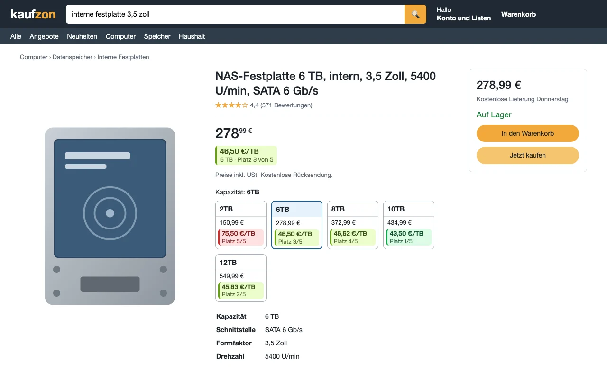
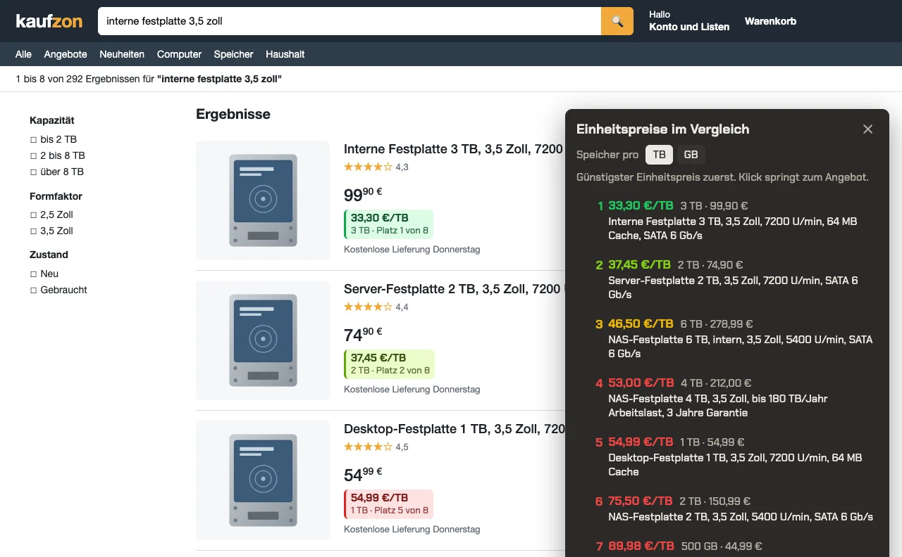

Beim Festplattenkauf zählt der Preis pro Terabyte. Der Shop zeigt 150,99 € für 2 TB, 434,99 € für 10 TB und 579,99 €
für 22 TB, rechnen muss der Käufer selbst. Bei Lebensmitteln gibt es dafür den Grundpreis. Bei Speicher fehlt er,
ebenso bei Waschmittel pro Waschladung oder bei Spültabs pro Stück. Deshalb habe ich mir eine kleine
Browser-Erweiterung bauen lassen. Sie schreibt unter jeden Preis den Einheitspreis, färbt ihn nach dem Abstand zum
günstigsten Angebot und sortiert auf Wunsch alle Angebote einer Seite danach.

Gebaut habe ich sie mit einem KI-Assistenten, an einem Abend von der ersten Nachricht bis zur ersten Version. Die
meiste Arbeit steckte danach in der Frage, ob die Zahlen stimmen.

**Das Wichtigste in Kürze**

- Der Preis pro Einheit steht direkt unter jedem Preis, zusammen mit der erkannten Menge ("5 x 32 GB"). So lässt sich
  jede Zahl nachprüfen. Auf Produktseiten bekommt jede Größe ihren eigenen Wert.
- Zuverlässig wurde die Erkennung erst an 910 echten Suchtreffern aus 14 Suchen, von Festplatten über Olivenöl bis
  Katzenfutter. Jede Runde gegen diese Daten hat Fehler gefunden, die kein ausgedachtes Beispiel gezeigt hätte.
- Typische Fallen sind Raten ("180 TB/Jahr"), Grenzwerte ("bis zu 24 TB"), Nebenangaben ("256 MB Cache"), Faktoren
  ohne Leerzeichen ("12x0,5l") und Packungsangaben, die schon in der Menge stecken.
- Der Grundpreis des Shops ist der beste Prüfstein, er stimmt aber nicht immer. In den Suchtreffern standen 0,01 € pro
  Liter Mineralwasser und 574,57 € pro Liter Olivenöl.
- Die Erweiterung liegt offen auf GitHub unter
  [HalloWelt42/einheitspreis](https://github.com/HalloWelt42/einheitspreis).

## Ausgangslage

Die Erweiterung sollte bei Festplatten den Preis pro GB oder TB zeigen, bei anderen Waren den Preis pro Liter oder
einer anderen passenden Einheit. Sie sollte zuverlässig rechnen und sich ohne Umweg in den eigenen Browser laden
lassen. Die Bilder in diesem Artikel zeigen einen neutralen Nachbau namens Kaufzon, auf dem die echte Erweiterung
läuft. Die Preise stammen aus einer echten Suche.

Auf der Produktseite kostet die 6-TB-Platte 278,99 €, also 46,50 € pro TB. Die 10-TB-Platte kostet mehr und ist mit
43,50 € pro TB trotzdem die günstigste Größe. Am Preis allein ist das nicht zu erkennen.

## Was passiert ist

### Aufbau der Seite lesen

Bevor eine Zeile Code entstand, hat der Assistent im Browser den Aufbau der Shopseiten gelesen. Er hat geprüft, wo
Titel und Preis eines Suchtreffers stehen, wie die Größenkacheln einer Produktseite aufgebaut sind, welcher Preis zu
zahlen ist und welcher der durchgestrichene Vergleichspreis ist. Außerdem hat er nachgesehen, wo der Shop bei
Lebensmitteln seinen eigenen Grundpreis zeigt. Dieses Wissen steckt in der Erweiterung in genau einer Datei. Ändert
der Shop seinen Aufbau, ist nur sie betroffen.

### Ein Rechenkern ohne Browser

Menge und Einheit aus einem Text wie "NAS-Festplatte 4 TB, 3,5 Zoll, 180 TB/Jahr" liest ein Rechenkern ohne jede
Browser-Schnittstelle. Er läuft deshalb auch im Terminal und prüft dort beliebig viele Titel in Sekunden.

### Echte Titel als Prüfstein

Der Assistent hat 14 Suchen mit je zwei Ergebnisseiten abgerufen und Titel, Preise und, wo vorhanden, den Grundpreis
des Shops gesammelt. Das ergab 910 verschiedene Angebote, 653 davon mit Grundpreis. Bei Speicher habe ich nach absurden und
fehlenden Preisen pro TB gesucht, bei allen anderen Waren nach Abweichungen zwischen der eigenen Rechnung und dem
Grundpreis des Shops.

Jede Runde fand etwas. Die Tabelle zeigt eine Auswahl.

| Titel (gekürzt) | Fehler | Ursache |
|---|---|---|
| "... Pro 8TB, 256 MB Cache" | 1.472.656 € pro TB | "pro" galt als Grenzwort wie in "pro Stück", die 8 TB fielen weg, übrig blieb der Cache |
| "Externe Festplatte,2TB" | keine Menge | eine Zahl direkt nach einem Komma galt als Nachkommastelle |
| "Waschpulver 3x10 kg" | keine Menge | eine Zahl direkt nach einem Buchstaben wurde verworfen, auch nach dem "x" eines Faktors |
| "1000 ml (3 x 1,0 l)" | 41,87 € statt 13,96 € pro Liter | die erste Angabe zählte statt der größten |
| "2 kg (2 Packungen mit 1 kg)" | halber Preis pro kg | die Packungszahl wurde noch einmal mit der Gesamtmenge malgenommen |
| "(5L/100 Waschladungen)" | keine Menge | jeder Schrägstrich nach einer Einheit galt als Rate wie "MB/s" |
| "1.595 lt." | 1595 Liter | Tausenderpunkt und Dezimalpunkt sehen gleich aus |

Nach den Korrekturen stimmte die eigene Rechnung bei 465 der 653 Angebote mit Grundpreis auf 2 % genau mit dem Shop
überein. Die übrigen Abweichungen sind überwiegend gewollt, weil die Erweiterung dort bewusst eine andere Einheit
wählt. Der Abschnitt "Was sich bewährt hat" erklärt das. Am Ende standen 37 automatische Tests, darunter einer, der
alle 910 Titel auf einen plausiblen Preis pro TB prüft.

### Wenn der Shop selbst falsch rechnet

Wo der Shop einen Grundpreis zeigt, ist er die verlässlichste Quelle, und die Erweiterung übernimmt ihn. Auch er
enthält Fehler. Zwölf Flaschen Mineralwasser mit 0,75 l standen mit "700 l" im Shop und kosteten so 0,01 € pro Liter.
Eine Flasche Olivenöl stand mit 574,57 € pro Liter in der Liste. Solche Ausreißer fallen erst auf, wenn man zwei
unabhängige Rechnungen nebeneinanderlegt.

### Die Liste

Auf einer Suchseite zeigt ein Knopf unten rechts den besten Preis pro Einheit. Ein Klick öffnet die Liste aller
Angebote der Seite, günstigster Einheitspreis zuerst. Ein Klick auf eine Zeile springt zum Angebot. Im Bild steht die
4-TB-Platte mit "180 TB/Jahr" im Titel richtig bei 53,00 € pro TB und nicht bei 1,18 € pro TB. Die USB-Sticks rechnet
die Erweiterung als "5 x 32 GB".

Nach dem ersten gemeinsamen Test im echten Shop habe ich nur die Schilder eine Spur verkleinert.

## Was sich bewährt hat

- Echte Daten haben die Fehler gefunden. Ein Titel wie "Externe Festplatte,2TB" schreibt niemand in einen Test, im
  Shop steht er trotzdem. Die 910 Titel liegen jetzt dauerhaft als Prüfstein bei den Tests.
- Zwei unabhängige Rechnungen zu vergleichen, hat Fehler auf beiden Seiten gezeigt, in der eigenen Rechnung und im
  Grundpreis des Shops.
- Die erkannte Menge steht immer mitunter dem Preis. Mit "5 x 32 GB" lässt sich jede Zahl nachprüfen, und ein falscher
  Wert fällt sofort auf.
- Die Einheit wähle ich bewusst. Für Waschmittel sagt der Preis pro Waschladung mehr als der pro Liter, weil
  Konzentrate verschieden ergiebig sind. Für Spültabs gilt der Preis pro Tab. Hier rechnet die Erweiterung selbst, auch
  wenn der Shop einen Grundpreis pro Liter oder Kilogramm angibt. Daher stammt der größte Teil der Abweichungen oben.
- Rechenkern und Seitenaufbau sind getrennt. Nur deshalb ließ sich die Erkennung in Sekunden gegen alle Titel prüfen.

## Was ich heute anders planen würde

- Die echten Daten würde ich zuerst sammeln. Hier kamen sie nach dem ersten Entwurf des Rechenkerns. Früher gesammelt,
  hätten sie den ersten Entwurf schon geformt.
- Mehrdeutige Angaben würde ich offen anzeigen. Bei "12x85g (4 Packungen)" ist unklar, ob es 12 oder 48 Beutel sind.
  Wo der Shop einen Grundpreis zeigt, gilt seiner. Ohne ihn wäre ein sichtbares Fragezeichen ehrlicher als eine Zahl.
- Offen ist noch, wie oft der Shop seinen Seitenaufbau ändert. Die Erweiterung liest ihn an einer einzigen Stelle. Wie
  lange diese Stelle hält, zeigt erst die Zeit.
